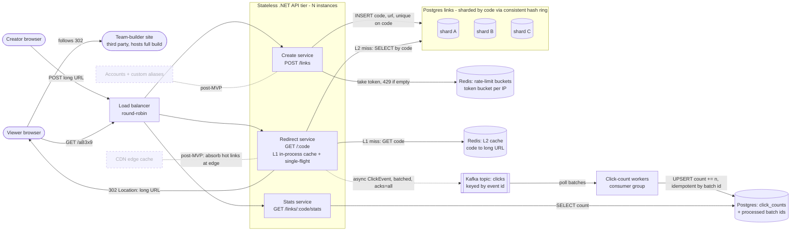
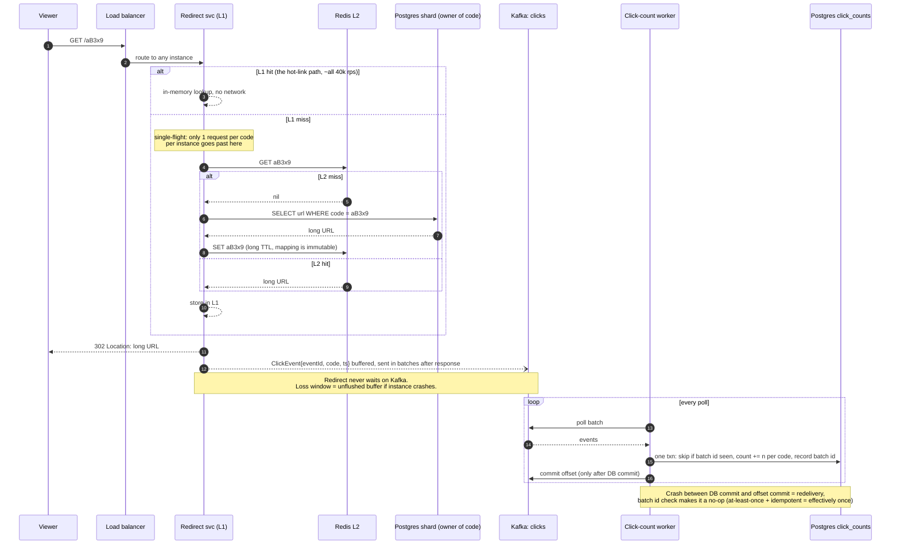

# System Design Playground: Build Plan

**Learning objective:** Build, break, and defend the core system design building blocks
(caching, sharding, rate limiting, queues) against real infrastructure, well enough to
combine them under pressure in a Hello Interview–style design round.
**Stack:** .NET / C# services, xUnit / Postgres, Redis, Kafka in Docker Compose (per lab) /
k6 for load, Prometheus + Grafana for observation / Claude Code CLI as grader / React + TS reserved for post-MVP UI
**MVP:** Four themed labs (each with failing tests, a break-it scenario, a quiz + rubric) and
one capstone (TeamLink, i.e. Design Bitly) that combines them, with every graded attempt logged.

## What you'll have at the end
A repo where `docker compose up` in any lab folder gives you real infrastructure, a starter
service with TODOs, and red tests. You'll have personally made each one green, watched each
one fail under a scripted scenario you predicted in advance, and been graded on explaining
why. The capstone is a full mock interview followed by building the design you defended.

## How work is split
Claude scaffolds each lab: compose file, starter code with TODOs, failing tests, k6
scenario, `quiz.md`, `rubric.md`, and the reference solution on the `solutions` branch.
**AJ does the lab.** Milestones below describe the lab outcome; the scaffolding is what
makes it possible.

## Architecture decisions
- **Real infra via Docker, compose per lab.** Interviews and jobs use real Redis/Kafka;
  per-lab compose keeps RAM under 16GB. *(AJ's call)*
- **Assessments = tests + break-it + quiz/rubric + mock interview.** Tests prove it works,
  break-it proves you understand how it fails, quizzes prove you can say it out loud. *(AJ's call)*
- **Claude in the CLI grades prose and diagrams against in-repo rubrics.** No API plumbing,
  and the rubric is reviewable. *(taken on recommendation)*
- **No UI in MVP; Grafana for metrics.** Building a frontend would spend learning budget
  on React instead of system design. *(taken on recommendation)*
- **Starters on `main`, reference solutions on `solutions`.** Peeking requires intent.
  *(taken on recommendation)*
- **Progress as Markdown in git.** `PROGRESS.md` + per-lab `attempts/`, so retries show
  improvement in history. *(taken on recommendation)*
- **Labs chosen to feed the capstone.** Cache, shard, rate-limit, and queue are exactly
  TeamLink's four hard parts. *(taken on recommendation)*
- **Themed on gaming / pop culture, canonical interview name kept alongside.** *(AJ's call)*

## System design (capstone: TeamLink, i.e. Design Bitly)
**Designed against:** a streamer drops one link to 500k viewers: 40k redirects/sec on a
single code within 10s; redirects <50ms; click counts may lag a minute but never lose a
click and never slow a redirect.
**Designed by:** Claude reference design, at AJ's request. AJ redraws and defends it in Phase 5.

Container diagram: every process, store, and third party, with what crosses each arrow.
Dashed boxes are post-MVP.

Sequence: one redirect, from click to the creator's count, including the crash-safe path.

**Key ideas to study:** three paths with different consistency needs (redirect is
read-only and immutable, create is correct and rare, analytics is durable and laggy); L1
kills the hot key; single-flight kills the stampede; shard key = the lookup key; key Kafka
by event id so the hot key doesn't become a hot partition; idempotent consumer + commit
after write = effectively-once.

**Open questions:**
- Fail open or fail closed on rate limiting when Redis is down, and which one does a
  spam-heavy launch day argue for?
- How big can each instance's click buffer get before you must choose between dropping
  clicks and blocking redirects?
- Is 302 (uncached, every click counted) vs 301 (browser-cached, clicks lost) the right
  call, and what would make 301 acceptable?
- At what traffic does the CDN box stop being post-MVP, and how do clicks get counted then?

---

## Phase 1: Harness + Lab 1, Pokédex Caching
**Goal:** The full lab loop (compose up → red tests → green → break-it → graded quiz →
logged attempt) works end to end on one real concept.
**Concept in focus:** Cache-aside and its failure modes (stale reads, TTL, stampede).
**Builds:** The `Redis: L2 cache` box and the `L1 miss: GET code` / `L2 miss: SELECT` arrows,
in Pokédex form.

### Milestone 1.1: The harness runs
A .NET solution, a lab folder convention, a shared k6 runner, Prometheus + Grafana compose,
`PROGRESS.md`, and a grading skill that reads `rubric.md` and writes to `attempts/`. Lab 1's
slow species service (Postgres with deliberate latency) responds, and its tests are red.

- **Concept:** Observability before optimization: you can't claim the cache helped
  without a p99 graph showing before and after.
- **Checkpoint:** Before writing any cache code, run the k6 baseline and write down the
  p50/p99 you see. That number is what every later claim is measured against.

### Milestone 1.2: Cache-aside makes the tests green
Implement read-through-on-miss, write the TTL, and handle the "species updated" path
(invalidate vs. update-in-place).

- **Concept:** Cache-aside: the app owns cache population, so the app owns its bugs.
  This is the exact pattern the TeamLink redirect path uses.
- **Checkpoint:** Defend the choice: three sentences on why you invalidate rather than
  update the cache on write, and the race condition the other choice opens.

### Milestone 1.3: The legendary reveal stampede
Break-it: the cache is cold, a new legendary is revealed, and k6 fires thousands of
simultaneous requests for one species. Predict DB query count first, run, then add
single-flight / request coalescing and re-run.

- **Concept:** Stampede / thundering herd. Caches fail hardest at the moment they matter most.
- **Checkpoint:** Break it deliberately: predict the exact number of DB queries for the
  cold-cache spike before running. Graded quiz on stampede mitigations (locking,
  coalescing, early refresh, jittered TTL) against `rubric.md`.

---

## Phase 2: Lab 2, Trainer Profile Sharding
**Goal:** Trainer profiles live across Postgres shards, and adding a shard moves a
minimal, predictable fraction of them.
**Concept in focus:** Partitioning and consistent hashing.
**Builds:** The `Postgres links: sharded by code` subgraph and its routing logic.

### Milestone 2.1: Naive modulo sharding works
Route trainer reads/writes by `hash(trainerId) % N` across three shards. Tests go green.

- **Concept:** Shard key choice: every query that doesn't include the shard key becomes
  a scatter-gather.
- **Checkpoint:** Explain it cold: which query in this lab would become a fan-out across
  all shards, and how would you avoid it?

### Milestone 2.2: Adding a shard breaks everything
Break-it: add a fourth shard. Predict what percentage of trainers now route to the wrong
shard, then run the migration-count script. This phase intentionally breaks 2.1.

- **Concept:** Why modulo hashing fails at resize. This is the motivation for the next
  milestone, not a side note.
- **Checkpoint:** Write your predicted % before running. Grade the gap.

### Milestone 2.3: Consistent hash ring with virtual nodes
Replace modulo with a ring. Re-run the add-a-shard scenario and measure keys moved; tune
virtual node count and observe load balance across shards.

- **Concept:** Consistent hashing moves ~1/N of keys; virtual nodes fix uneven load.
- **Checkpoint:** Rebuild it: implement the ring lookup again on a blank file without
  referencing your solution. Graded quiz on hot shards and resharding strategies.

---

## Phase 3: Lab 3, Gacha Pull Rate Limiting
**Goal:** A rate limiter that holds when the API runs as multiple instances behind a
load balancer.
**Concept in focus:** Distributed state and atomicity.
**Builds:** The `Redis: rate-limit buckets` box and the `take token, 429 if empty` arrow.

### Milestone 3.1: In-memory token bucket passes
Implement a token bucket for gacha pulls in process. Single-instance tests go green.

- **Concept:** Token bucket vs. fixed window vs. sliding log: burst tolerance is a
  product decision, not just an algorithm choice.
- **Checkpoint:** Defend the choice: why token bucket and not fixed window for a gacha
  pull endpoint, with the specific abuse each one allows.

### Milestone 3.2: Two instances, double the pulls
Break-it: compose scales the API to two instances behind a round-robin proxy. Predict
how many pulls get through per player, then run. This intentionally breaks 3.1.

- **Concept:** Per-instance state is wrong state once you scale horizontally.
- **Checkpoint:** Predict the exact allowed-pulls number before running.

### Milestone 3.3: Atomic Redis limiter
Move the bucket to Redis with an atomic script. Then break-it again: race many concurrent
requests and verify no over-grant. Then kill Redis and decide fail-open vs fail-closed.

- **Concept:** Read-modify-write across a network is a race unless it's atomic.
- **Checkpoint:** Explain it cold: what the non-atomic GET-then-SET version gets wrong
  under concurrency, step by step. Graded tradeoff prompt: fail open vs closed for gacha.

---

## Phase 4: Lab 4, Battle Results → Ranked Ladder
**Goal:** Battle results flow through Kafka into ladder rankings with no double counting,
even when workers crash.
**Concept in focus:** Async processing, delivery guarantees, idempotency.
**Builds:** The `Kafka topic: clicks`, `Click-count workers`, and `click_counts` boxes, in
battle-ladder form.

### Milestone 4.1: Producer → topic → consumer works
The battle service publishes results; a ladder worker consumes and updates rating points.
Tests go green on the happy path.

- **Concept:** Decoupling: the battle service no longer cares if the ladder is slow or down.
- **Checkpoint:** Delete one box: the ladder worker is down for a minute. What does a
  player see, and what's in Kafka when it comes back?

### Milestone 4.2: Crash mid-batch, double-counted wins
Break-it: kill the worker after the DB write but before the offset commit. Predict the
ladder state after restart, then run. This intentionally breaks 4.1.

- **Concept:** At-least-once delivery means duplicates are guaranteed, not hypothetical.
- **Checkpoint:** Predict the exact double-counted rating points before running.

### Milestone 4.3: Idempotent consumer
Make processing idempotent (dedupe by event/batch id in the same transaction as the
write; commit offset after). Re-run the crash scenario until it's clean. Then test
partition keying: key by player vs by event id and observe ordering and hot partitions.

- **Concept:** At-least-once + idempotency = effectively-once; partition key decides
  both ordering and hot spots.
- **Checkpoint:** Defend the choice: when should battle results be keyed by player id
  (ordering) vs event id (spread), and what breaks with each. Graded quiz.

---

## Phase 5: Capstone, TeamLink (Design Bitly)
**Goal:** Pass a mock interview on TeamLink, then build the design from your lab parts
and survive the streamer hot-key scenario.
**Concept in focus:** Composition under a constraint: choosing which building block
solves which part of a real requirement.
**Builds:** Everything on the container diagram except the dashed boxes.

### Milestone 5.1: Mock interview, cold
Without looking at this file, run the full Hello Interview flow (requirements → entities
→ API → high-level design → deep dives) for TeamLink in Mermaid. Claude grades it against
the capstone rubric.

- **Concept:** Interview structure: the building blocks are worthless if you can't
  sequence the conversation.
- **Checkpoint:** Redraw it cold: diff your container diagram against the reference in
  this file. Every forgotten box is the one to reread. Log the confidence/score gap.

### Milestone 5.2: TeamLink runs end to end
Assemble create (rate-limited, sharded insert), redirect (Redis-cached), and click
counting (Kafka + idempotent worker) from your lab code. Integration tests go green.

- **Concept:** The seams between building blocks are where real systems break: config,
  timeouts, and who owns retries.
- **Checkpoint:** Explain it cold: trace one click from browser to the stats endpoint,
  naming every network hop and what happens if each one fails.

### Milestone 5.3: The streamer drop
Break-it: k6 fires 40k rps at one code. Predict whether Redis-only caching from Lab 1
holds the 50ms budget, then run. Add the L1 in-process cache + single-flight and re-run.
Kill Kafka mid-spike and verify redirects stay fast. Update the Mermaid if your design
diverged from the reference. This intentionally breaks Lab 1's assumption.

- **Concept:** Hot keys: a distributed cache still has a single owner per key.
- **Checkpoint:** Defend the choice: why L1 is safe here (immutable mapping) and the
  exact property of a different system that would make L1 dangerous.

---

## MVP is done when
- All four labs are green on `main` with your code, and each has at least one graded
  attempt in `attempts/`.
- Every break-it scenario has a written prediction logged before its result.
- TeamLink survives the 40k rps single-code scenario under 50ms with zero lost clicks
  in the idempotent counter (excluding a documented crash-buffer window).
- You've passed the TeamLink mock interview cold, and the calibration gap is logged.

## Deliberately not in the MVP
- React + TypeScript lab console (start scenarios, live charts)
- More labs: replication + read-your-writes, CAP/consistency, search (Elasticsearch),
  blob storage, real-time updates (WebSockets/SSE), contention (Ticketmaster seat locks),
  distributed transactions/sagas, leader election
- More capstones: leaderboard, Ticketmaster (tournament tickets), WhatsApp (guild chat),
  news feed, YouTube (speedrun VOD hosting)
- CDN layer and 301-vs-302 analytics tradeoff in TeamLink
- Accounts, custom aliases, link expiry
- Spaced-repetition re-quizzing of past labs
